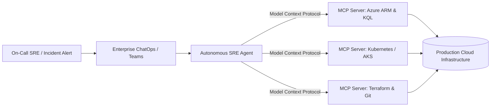
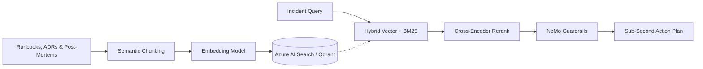
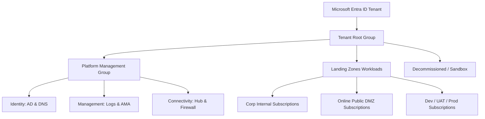
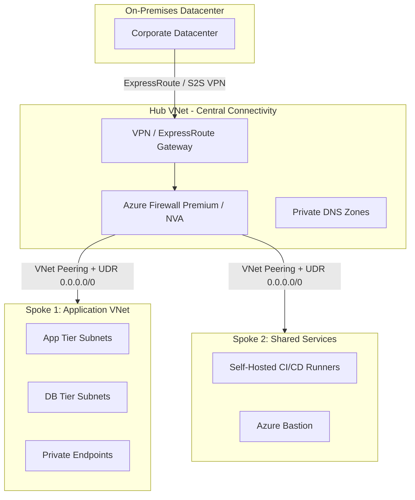
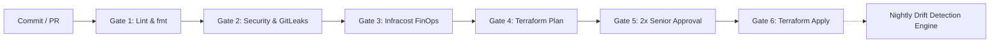
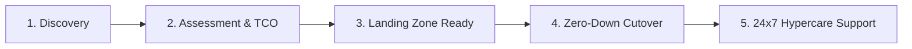

<div align="center">

<!-- ============================================================ -->
<!-- 🌊 EXACT OCEAN BLUE WAVE BANNER (INSPIRED BY SAMPLE PHOTO)   -->
<!-- ============================================================ -->


<!-- ============================================================ -->
<!-- ⚡ DYNAMIC MONOSPACE TYPING SUBTITLE                         -->
<!-- ============================================================ -->
<a href="https://github.com/yogeshpujari0905-droid">
  
</a>

<br/>

### 🔐 Senior Cloud & DevSecOps Architect | AI Platform Systems Leader (10+ Yrs Exp)
**Cloud Infrastructure • Automation • Security • Agentic AI • FinOps • Enterprise Scale**

<br/>

<!-- ============================================================ -->
<!-- 📍 ELEGANT PILL BADGES (MATCHING REFERENCE DESIGN)           -->
<!-- ============================================================ -->
<a href="https://linkedin.com/in/ycpujari-devops" target="_blank"></a>
<a href="https://github.com/yogeshpujari0905-droid?tab=repositories" target="_blank"></a>
<a href="mailto:yogeshpujari0905@gmail.com"></a>


</div>

---

## 👋 About Me

I am a **Principal / Senior Cloud & DevSecOps Solutions Architect** with **10+ years of enterprise engineering leadership** across hyperscale cloud platforms, infrastructure automation, zero-trust cybersecurity, and modern **Agentic AI systems**.

My mission is to design self-healing, cost-efficient, and mathematically secure cloud environments that bridge the gap between high-level executive business strategy and deep, reliable production execution. Having led the migration of **100+ mission-critical enterprise workloads** to Microsoft Azure with zero business downtime, I specialize in combining battle-tested **Cloud Adoption Framework (CAF)** landing zones with cutting-edge **Model Context Protocol (MCP)** agentic pipelines and **Enterprise RAG architectures**.

---

## ⚡ 20 Core Architectural & DevSecOps Superpowers

Here is a sharp summary of my 10-year production track record, architectural pillars, and technical capabilities:

* 🕒 **10+ Years Enterprise Experience:** Architecting, deploying, and governing hyperscale cloud environments across Microsoft Azure, AWS, and Hybrid Datacenters.
* 🚀 **100+ Enterprise Workload Migrations:** Successfully planned and executed zero-downtime migrations from on-premises datacenters to Azure Cloud Adoption Framework (CAF) Landing Zones.
* 🤖 **Agentic AI & Model Context Protocol (MCP):** Engineering secure MCP tool servers that connect LLMs directly to Azure ARM APIs, Kubernetes clusters, and telemetry for autonomous infrastructure triage.
* 🧠 **Enterprise Private RAG Architecture:** Designing vector-indexed retrieval systems (Azure AI Search, Qdrant) providing instant, hallucination-free access to enterprise runbooks, ADRs, and post-mortems.
* 🛠️ **Autonomous SRE Copilots:** Deploying intelligent incident investigation agents that correlate KQL logs across microservices and generate automated root-cause analyses in sub-minute intervals.
* 🏛️ **Azure CAF Management Group Hierarchy:** Structuring multi-tenant enterprise hierarchies, subscription boundaries (`Platform` vs `Workload`), and guardrails with zero unauthorized console bypass.
* 🌐 **Enterprise Hub-and-Spoke Networking:** Architecting central Hub VNets with Azure Firewall Premium (TLS inspection), User Defined Routes (`0.0.0.0/0`), and private DNS zone resolution.
* 🔒 **100% Private PaaS Connectivity:** Eliminating public exposure by deploying Azure Private Endpoints across Key Vaults, Databases, and Storage Accounts.
* 🛡️ **Zero-Trust Identity & Access Governance:** Enforcing Microsoft Entra ID with Conditional Access, Multi-Factor Authentication (MFA), and Privileged Identity Management (PIM) with JIT approvals.
* ⚡ **Shift-Left DevSecOps Gateways:** Embedding automated code analysis (`Checkov`, `tfsec`, `Trivy`, `GitLeaks`, `SonarQube`) directly into pull request checks before staging merge.
* 📜 **Modular Infrastructure as Code (IaC):** Authoring production-grade, reusable Terraform and Terragrunt modules with strict semantic versioning and remote state blob lease locking.
* 🔄 **Automated IaC Drift Detection:** Operating scheduled nightly pipelines running `terraform plan -detailed-exitcode` to instantly alert on manual portal modifications.
* 💰 **FinOps Mastery (28%+ Cost Optimization):** Slashing cloud waste through aggressive VM rightsizing, 1-yr/3-yr Reserved Instances, automated non-prod schedules, and orphan resource purging.
* 💵 **GenAI / LLMOps Token Economics:** Optimizing generative AI operational costs by up to 45% through semantic caching (Redis) and intelligent model fallback routing.
* ⚖️ **Automated Policy as Code:** Enforcing continuous compliance with CIS Azure Benchmarks, MCSB, and custom Azure Policy initiatives with automated audit and deny effects.
* 🏰 **High Availability & Disaster Recovery (99.99% SLA):** Engineering multi-AZ and paired-region architectures (ZRS/GRS, VMSS, Azure Site Recovery) with strict RTO (< 1h) and RPO (< 15m) standards.
* 📦 **Kubernetes & Cloud-Native Platforms (AKS):** Deploying enterprise Azure Kubernetes Service clusters with Helm charts, ingress controllers, network policies, and service mesh.
* 🚦 **Enterprise CI/CD Governance:** Enforcing trunk-based development, branch protection on `main`, mandatory PRs with 2 senior reviewers, and automated rollback workflows.
* 📈 **Deep Observability & Telemetry:** Architecting Azure Monitor, Log Analytics (KQL), Azure Monitor Agent (AMA), and Data Collection Rules (DCR) to cut diagnostic log noise by 40%.
* 🤝 **Executive Delivery & Vendor Governance:** Leading technical RFP/RFI vendor evaluations, SOW scope authoring, RACI escalation governance, and mentoring top-tier engineering talent.

---

## 🛠️ Technology Stack & Arsenal

* **Cloud Platforms:** Microsoft Azure, Amazon Web Services (AWS), Google Cloud Platform (GCP), Hybrid Enterprise Datacenters
* **Agentic AI & LLMOps:** Model Context Protocol (MCP), LangChain, LangGraph, LlamaIndex, Semantic Kernel, Azure OpenAI, Ollama, NeMo Guardrails
* **Vector Databases & Search:** Azure AI Search, Qdrant, Pinecone, ChromaDB, PGVector
* **Infrastructure as Code (IaC):** Terraform, Terragrunt, Ansible, Azure Bicep, ARM Templates, Cloud-Init
* **DevSecOps & Security Tools:** Checkov, Aqua Trivy, tfsec, GitLeaks, SonarQube, Microsoft Defender for Cloud, HashiCorp Vault
* **Containers & Orchestration:** Kubernetes (AKS / EKS), Docker, Helm, Istio Service Mesh, Azure Container Apps
* **CI/CD & Automation:** Azure DevOps Pipelines, GitHub Actions, GitLab CI, ArgoCD, Jenkins
* **Identity & Governance:** Microsoft Entra ID, Azure PIM, RBAC, Azure Policy, CIS Benchmarks, ISO 27001
* **FinOps & Cloud Economics:** Infracost, Azure Cost Management, Reserved Instances, Savings Plans, Token FinOps
* **Monitoring & SRE:** Azure Monitor, Log Analytics (KQL), Azure Monitor Agent (AMA), Data Collection Rules (DCR), Prometheus, Grafana

---

## 🚀 Featured Enterprise Terraform Landing Zone Projects

Production-grade Infrastructure as Code modules adhering to advanced architectural patterns (`for_each` over `map(object)`, dynamic blocks, and strict semantic versioning):

* [**01. Enterprise CAF Hub-and-Spoke Network Module**](./terraform-projects/01-azure-hub-spoke-network)
  * **Architecture Pattern:** Data-driven VNet and Subnet generation via flattened composite keys; dynamic UDRs directing `0.0.0.0/0` traffic to Azure Firewall Premium.
  * **Key Features:** Automated bidirectional VNet peering, Network Security Groups with dynamic security rules, zero overlapping CIDRs.
* [**02. Enterprise Governance & Policy as Code Landing Zone**](./terraform-projects/02-azure-governance-policy-landingzone)
  * **Architecture Pattern:** Recursive Management Group hierarchy with automated initiative assignment using `for_each` over `map(object)`.
  * **Key Features:** Built-in CIS Azure Foundations Benchmark and MCSB policy enforcement with System-Assigned Managed Identity remediation.
* [**03. Zero-Trust Azure PaaS Private Endpoint Mesh**](./terraform-projects/03-azure-private-endpoints-paas-mesh)
  * **Architecture Pattern:** Multi-PaaS private endpoint automation with dynamic `private_dns_zone_group` and Hub Private DNS Zone links.
  * **Key Features:** Complete public internet isolation for Key Vaults, Storage Accounts, and Databases with RFC 1918 private addressing.
* [**04. Hardened Enterprise Azure Kubernetes Service (AKS) Cluster**](./terraform-projects/04-azure-enterprise-aks-landing-zone)
  * **Architecture Pattern:** Isolated system node pool with dynamic user, GPU, and FinOps Spot node pools via `for_each` over `map(object)`.
  * **Key Features:** Azure CNI Overlay, Workload Identity, Key Vault Secrets Provider CSI driver, and node-level taints/labels.
* [**05. FinOps Multi-AZ VM Scale Sets (VMSS) Workload Engine**](./terraform-projects/05-azure-finops-vmss-workloads)
  * **Architecture Pattern:** High-availability VMSS across Availability Zones (`1`, `2`, `3`) with dynamic metric-driven autoscale rules.
  * **Key Features:** Automated scale-out under peak CPU and automated scale-in during idle periods to eliminate cloud compute waste.

---

## 🏛️ Enterprise Reference Architecture Blueprints

### 1. Enterprise Agentic SRE & Model Context Protocol (MCP) Mesh
*Standardizing secure communication between LLMs and enterprise production systems:*



* **Custom Infrastructure MCP Servers:** Exposing controlled ARM APIs, Kubernetes cluster metrics, and Log Analytics queries directly to AI agents.
* **Least-Privilege Tool Execution:** Agents execute infrastructure diagnostics, query telemetry, and generate proposed Terraform diffs within strict sandbox constraints with human approval.

---

### 2. Enterprise Zero-Trust RAG Architecture for Cloud Operations
*Semantic knowledge retrieval engine empowering engineers with verified runbooks, ADRs, and automated remediation:*



* **Hybrid Search & Vector Indexing:** Utilizing Azure AI Search and Qdrant with semantic re-ranking and chunking strategies tailored for code and infrastructure YAMLs.
* **Incident Copilots:** Sub-second retrieval of relevant past incident RCA documents, step-by-step remediation scripts, and topology graphs during active production outages.

---

### 3. Enterprise Cloud Adoption Framework (CAF) Management Group Hierarchy
*Scalable multi-tenant governance isolating platform shared services from business application workloads:*



* **Subscription Boundaries:** Separate subscriptions by environment (`Dev`, `UAT`, `Prod`) and function (`Platform` vs `Application`) to prevent noisy neighbors and isolate blast radiuses.
* **Azure Policy & Initiatives:** Assign built-in initiatives (CIS Azure Benchmark, MCSB) at Management Group level; enforce audit/deny effects with documented, time-bound policy exemptions.
* **RBAC & PIM:** Group-based RBAC with Microsoft Entra ID; enforce Privileged Identity Management (PIM) with just-in-time access and multi-stage approvals.

---

### 4. Enterprise Hub-and-Spoke Secure Networking Architecture
*Zero-trust network segmentation ensuring total traffic inspection, zero overlapping CIDRs, and private-only ingress/egress:*



* **IP Address Management (IPAM) & CIDR:** Comprehensive assessment of on-prem CIDRs ensuring zero overlapping address spaces with Azure VNets.
* **Centralized Traffic Inspection:** User Defined Routes (UDRs) forcing `0.0.0.0/0` and inter-spoke traffic through Azure Firewall Premium with TLS inspection.
* **Private Connectivity:** Private Endpoints for all PaaS services (Key Vault, Storage, SQL) with central Private DNS Zone resolution linked to the Hub.

---

### 5. Shift-Left DevSecOps & Automated Terraform Pipeline Flow
*Automated gates enforcing security, formatting, drift prevention, and cost estimation prior to manual production promotion:*



* **Remote State Management:** Remote state stored in private Azure Storage Account with blob lease locking, encrypted at rest, and accessed via Least Privilege Managed Identities.
* **Modularity:** Reusable, parameterized Terraform modules with strict semantic versioning.
* **Automated Drift Detection:** Scheduled night pipelines running `terraform plan -detailed-exitcode` to catch manual console changes immediately.

---

### 6. End-to-End Enterprise Migration Strategy (100+ Workloads)
*A proven 5-stage transformation lifecycle executed across Development, UAT, and Production environments:*



* **Pre-Migration:** Discovery reports (Azure Migrate), dependency mapping, bandwidth sizing, target Landing Zone verification, backup verification.
* **During-Migration (Cutover):** Traffic rerouting, database replication sync, DNS TTL reduction, validation tests.
* **Post-Migration & Hypercare:** Health telemetry checks, end-user sanity testing, performance benchmarking, 2-4 weeks dedicated war room support.

---

## 🛡️ Multi-Layered Defense-in-Depth Security Matrix

* **🔑 Identity Level:** Microsoft Entra ID, Conditional Access, Multi-Factor Authentication (MFA), Privileged Identity Management (PIM), Service Principals / Workload Identities.
* **🌐 Networking Level:** Hub-and-Spoke, Micro-segmentation via NSGs/ASGs, Azure Firewall Premium (TLS Inspection), Private Endpoints, DDoS Protection Standard.
* **⚖️ Governance Level:** Azure Policy enforcement, CIS / ISO27001 regulatory compliance benchmarks, Microsoft Defender for Cloud Secure Score.
* **💻 Compute & Data Level:** Defender for Servers, automated vulnerability scanning, Disk Encryption with Customer Managed Keys (CMK), automated OS patch baselines.
* **🤖 AI & LLM Level:** NeMo Guardrails, Prompt Injection Shields, Token Rate-Limiting, Data Loss Prevention (DLP) on RAG Vectors, Model Access Auditing.

---

## 💎 The 10 Scalability & Quality Pillars

Every infrastructure module and platform system is measured against 10 non-negotiable architectural pillars:

1. **Scalable:** Horizontal scaling via VM Scale Sets (VMSS) and AKS Horizontal Pod Autoscalers (HPA) under peak load.
2. **Robust:** Self-healing health probes, circuit breaker patterns, and retry mechanisms with automated recovery.
3. **Secure:** Zero-trust architecture, automated shift-left security scans, and 100% credential-free pipelines via Managed Identities.
4. **Reliable:** Multi-AZ deployments, redundant data paths, and failover validation drills with 99.99% target uptime SLA.
5. **Portable:** Containerized workloads, cloud-agnostic Terraform abstractions, and Helm charts preventing vendor lock-in.
6. **Governed:** Enterprise Management Groups, Azure Policy as Code, and continuous CIS benchmark compliance.
7. **High Availability:** Zone-Redundant Storage (ZRS), Geo-Redundant Storage (GRS), and Paired Regions with zero single points of failure.
8. **Cost-Optimized:** FinOps automated shutdown schedules, Rightsizing percentiles, and Reserved Instances delivering 25–35% cloud waste reduction.
9. **Backed Up:** Immutable Azure Backup vaults, automated snapshot policies, and tested restore drills (RTO < 1h, RPO < 15m).
10. **Monitored:** Azure Monitor Agent (AMA), Data Collection Rules (DCR), and KQL alerts routed dynamically to Teams/Slack.

---

## 💰 Cloud FinOps & AI Token Economics Framework

* **Eliminate Waste:** Detect and remove unattached managed disks, obsolete snapshots, unassociated public IPs, and idle compute instances.
* **Rightsizing:** Resize oversized VMs based on 30-day CPU/Memory utilization percentiles; modernize compute SKUs.
* **Commitment Discounts:** Reserved Instances (1-year or 3-year RI) and Azure Savings Plans for steady-state workloads.
* **Automated Scheduling:** Automated start/stop for non-production environments outside business hours.
* **Log Ingestion Tuning:** Review Azure Monitor log ingestion tables; configure Data Collection Rules (DCR) to filter noisy diagnostic logs, saving up to 40% in monthly fees.
* **GenAI Token Optimization:** Semantic response caching (Redis) and model fallback routing (lightweight models for triage, frontier models for complex remediation), cutting monthly LLM operational costs by 45%.
* **FinOps in CI/CD:** Integrated `Infracost` into pull requests, displaying monthly delta cost projections before code merge.

---

## 🔄 Disaster Recovery (DR) & Business Continuity

* **Storage Redundancy:**
  * **LRS (Locally Redundant Storage):** 3 copies within a single datacenter covering disk or rack failures.
  * **ZRS (Zone-Redundant Storage):** 3 copies across 3 availability zones covering entire datacenter outages.
  * **GRS (Geo-Redundant Storage):** Replicated to a secondary paired region covering regional catastrophic failures.
* **High Availability Compute:** Virtual Machine Scale Sets (VMSS) across multiple Availability Zones.
* **RTO & RPO Definitions:**
  * **RTO (Recovery Time Objective):** Standardized recovery procedures targeting `< 1 hour` full workload restore.
  * **RPO (Recovery Point Objective):** Transactional database replication and continuous log shipping ensuring `< 15 minutes` data variance.
* **Region Strategy:** Primary active region with Azure Site Recovery (ASR) replicating to secondary paired region with quarterly non-disruptive DR drills.

---

## 🤝 Vendor Management & Delivery Governance

Senior technical architects operate as executive partners across procurement, vendor accountability, and delivery quality:

* **SOW (Statement of Work):** Formal document detailing scope, deliverables, acceptance criteria, timeline, milestones, and liabilities.
* **Technical Evaluation Matrix:** Scoring vendors objectively against architecture capabilities, security compliance, past experience, and pricing.
* **RACI Matrix:**
  * **Responsible:** Who executes the task.
  * **Accountable:** The single individual answerable for deliverable completion.
  * **Consulted:** Subject matter experts providing input.
  * **Informed:** Stakeholders kept updated on progress.
* **Escalation Matrix:** Clearly defined escalation paths and SLAs when technical blockers or contract breaches occur.
* **Transition & Knowledge Transfer:** Formal documentation handover, runbooks, architecture walk-throughs, and shadowing before sign-off.

---

## 💼 IT Career Tracks & Roles Matrix

* **Sales:** Business development, lead generation, client relationships.
* **Pre-Sales (Techno-Functional):** RFPs/RFIs, technical demonstrations, solution estimations, commercial proposals.
* **TAM (Technical Account Manager):** Trusted technical advisor, governance, operational escalations, account health.
* **Enterprise Architect:** Holistic technology blueprint spanning infrastructure, security, data, and application ecosystems.
* **Technical Lead:** Hands-on leadership, sprint execution, code/IaC reviews, architecture enforcement.

---

## 📦 Production IaC & DevSecOps Engineering Standards

### 1. Enterprise Terraform Repository Architecture
```text
terraform-azure-landing-zones/
├── modules/
│   ├── networking/          # Hub-and-Spoke, Azure Firewall, UDRs, Private DNS
│   ├── identity/            # Microsoft Entra ID groups, PIM, custom RBAC roles
│   ├── security/            # Key Vault, Customer Managed Keys, NSGs, ASGs
│   └── compute/             # AKS clusters, VMSS multi-AZ, Container Apps
├── environments/
│   ├── dev/                 # Development root with remote backend lock
│   ├── uat/                 # Staging & QA mirror
│   └── prod/                # Production with dual-peer review gates
└── .github/workflows/       # Automated 6-gate CI/CD shift-left pipelines
```

### 2. Enterprise DevSecOps CI/CD Pipeline Template Flow
```yaml
# Production DevSecOps Multi-Stage Gate Specification
stages:
  - stage: Validate_And_Lint
    jobs:
      - job: Static_Analysis
        steps:
          - script: terraform fmt -check && tflint
          - script: gitleaks detect --verbose

  - stage: Security_And_FinOps_Gate
    jobs:
      - job: Vulnerability_Scan
        steps:
          - script: checkov -d . --framework terraform --compact
          - script: trivy config . --severity HIGH,CRITICAL
          - script: infracost breakdown --path . --format json

  - stage: Terraform_Plan
    jobs:
      - job: Plan_Execution
        steps:
          - script: terraform plan -out=tfplan.binary
          - publish: tfplan.binary

  - stage: Production_Apply
    jobs:
      - deployment: Apply_Prod
        environment: 'Enterprise-Production' # Requires 2x Senior Architect Manual Approval
        strategy:
          runOnce:
            deploy:
              steps:
                - script: terraform apply tfplan.binary
```

---

## 🔍 KQL Operational Telemetry & SRE Incident Queries

During active production incidents, automated agents and on-call squads execute optimized Kusto Query Language (KQL) scripts to diagnose anomalies in seconds:

```kusto
// Instant Failure Correlation across Distributed Microservices
AppTraces
| where TimeGenerated > ago(15m)
| where SeverityLevel >= 3 // Warnings & Errors
| summarize ErrorCount = count(), LastSeen = max(TimeGenerated) by OperationName, Message
| top 10 by ErrorCount desc
```

```kusto
// Centralized Azure Firewall Threat Intelligence & Blocked Traffic
AzureDiagnostics
| where Category == "AzureFirewallNetworkRule"
| where Action_s == "Deny"
| summarize DenyCount = count() by SourceIP_s, DestinationIP_s, DestinationPort_d
| order by DenyCount desc
```

---

## 📋 100+ Workload Cloud Migration Operational Playbook

* **Phase 1: Discovery & Dependency Mapping:** Deploy Azure Migrate appliance; discover physical/virtual inventory; map inter-app latency and TCP port dependencies.
* **Phase 2: TCO & 6-R Assessment:** Categorize workloads (Rehost, Replatform, Refactor, Repurchase, Retain, Retire); establish cloud business ROI justification.
* **Phase 3: Landing Zone Readiness:** Provision CAF Hub-and-Spoke networks, ExpressRoute private peering, automated target subscriptions, and least-privilege RBAC.
* **Phase 4: Zero-Downtime Cutover:** Seed continuous database replication; execute pre-cutover validation scripts; schedule maintenance cutover window; flip DNS TTL to Azure Front Door / Application Gateway.
* **Phase 5: Hypercare & Optimization:** Maintain 24x7 war room for 14–30 days; baseline system telemetry; conduct FinOps rightsizing reviews; hand over documented SOP runbooks.

---

---

## 📊 Live GitHub Analytics

<div align="center">

<table border="0">
  <tr>
    <td>
      
    </td>
    <td>
      
    </td>
  </tr>
</table>

<a href="https://github.com/yogeshpujari0905-droid">
  
</a>

</div>

---

## 💬 Let's Connect & Collaborate

I am always open to discussing **Enterprise Cloud Migrations**, **Zero-Trust DevSecOps**, **Autonomous AI Agents & MCP Infrastructure**, and **Principal / Lead Architect Roles**.

<div align="center">

<a href="https://linkedin.com/in/ycpujari-devops" target="_blank"></a>
&nbsp;&nbsp;
<a href="mailto:yogeshpujari0905@gmail.com"></a>
&nbsp;&nbsp;
<a href="https://github.com/yogeshpujari0905-droid?tab=repositories" target="_blank"></a>

<br/><br/>

<sub>⚡ Designed for Enterprise Cloud & AI Excellence • © Yogesh Pujari</sub>

</div>
